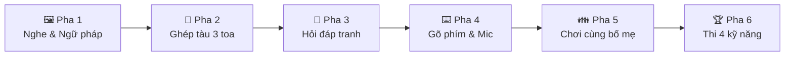
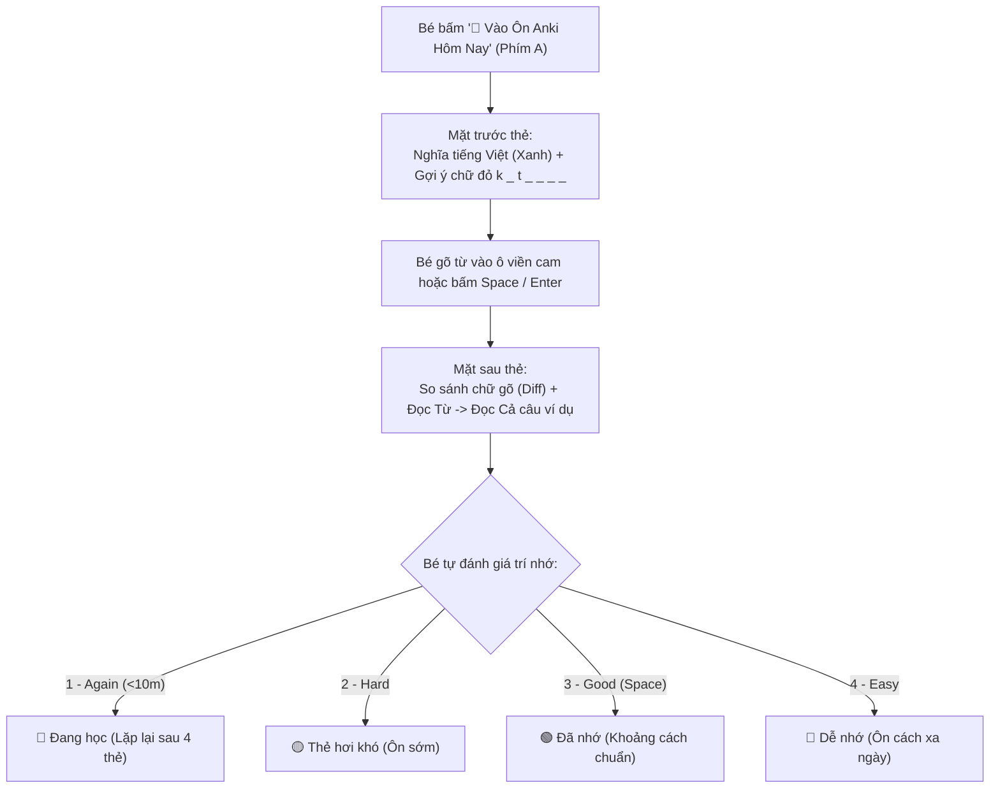

# 🌟 CẨM NANG HƯỚNG DẪN TỰ HỌC TIẾNG ANH TẠI NHÀ
### *Dành cho Bố Mẹ và các Bé (Từ cơ bản A0 đến tự tin giao tiếp)*

---

## 👨‍👩‍👧 Lời Mở Đầu Dành Cho Bố Mẹ

Chào Bố Mẹ! Khóa học được thiết kế đặc biệt theo phương pháp **Phản xạ Đa giác quan** và **Lặp lại Ngắt quãng (SRS/Anki)**. Bố Mẹ không cần giỏi tiếng Anh vẫn có thể đồng hành cùng con một cách nhẹ nhàng. Mỗi ngày chỉ cần **15 – 20 phút**, bé sẽ tự động xây dựng nền tảng ngữ pháp tự nhiên, phát âm chuẩn người bản xứ và ghi nhớ từ vựng vĩnh viễn vào trí nhớ dài hạn.

---

## 🚀 I. LỘ TRÌNH HỌC 6 PHA TRONG MỖI BÀI HỌC (CHỈ 15–20 PHÚT)

Mỗi bài học được chia thành 6 chặng nhỏ vui nhộn, bé học như chơi game:

### 1. 🖼️ Pha 1: Nghe & Ngữ Pháp Trực Quan (4 phút)
* **Mục tiêu:** Giúp bé làm quen với 4 câu giao tiếp mẫu và quy luật ghép câu thông qua hình ảnh sinh động.
* **Cách học:**
  * Bé bấm phím **`Space`** hoặc bấm vào thẻ tranh để nghe giọng đọc bản xứ.
  * Bấm phím **`1, 2, 3, 4`** hoặc mũi tên **`← / →`** để xem từng câu.
  * **Mẹo nhỏ:** Bấm trực tiếp vào từng ô màu (ví dụ: *the kitchen*, *on my bed*) để xem nghĩa chi tiết, phiên âm và nghe phát âm riêng của cụm đó.
  * Bấm **`Enter`** để chuyển sang Pha 2.

### 2. 🚂 Pha 2: Ghép Tàu 3 Toa (4 phút)
* **Mục tiêu:** Rèn luyện phản xạ ngữ pháp tự nhiên (Chủ ngữ + Động từ + Vị trí/Tân ngữ) mà không cần học vẹt công thức khô khan.
* **Cách học:**
  * Toa tàu đang chạy vào ga! Bé nghe âm thanh câu mẫu và bấm các phím **`1, 2, 3, 4`** để chọn đúng toa gắn vào đoàn tàu.
  * Bấm **`Backspace`** nếu muốn chọn lại toa tàu trước.

### 3. 💬 Pha 3: Hỏi Đáp Tranh (3 phút)
* **Mục tiêu:** Luyện phản xạ đối thoại hỏi – đáp theo các tình huống thực tế.
* **Cách học:**
  * Nghe máy hỏi (ví dụ: *"Where is Mom?"*).
  * Bấm phím số **`1, 2, 3, 4`** để chọn câu trả lời đúng với bức tranh (ví dụ: *"Mom is in the kitchen"*).

### 4. ⌨️ Pha 4: Gõ Phím & Luyện Đọc Mic (4 phút)
* **Mục tiêu:** Khắc sâu mặt chữ vào trí nhớ cơ bắp (Muscle Memory) và sửa phát âm.
* **Cách học:**
  * Bé nhìn màn hình và dùng 10 ngón tay gõ từng chữ cái trực tiếp từ bàn phím.
  * Bấm vào chiếc micro 🎤 để đọc theo và nhận điểm phát âm.

### 5. 👪 Pha 5: Chơi Cùng Bố Mẹ (3 phút)
* **Mục tiêu:** Tạo không khí gắn kết gia đình, giúp bé tự tin thể hiện kiến thức trước mặt bố mẹ.
* **Cách học:**
  * Bố mẹ đóng vai người nghe hoặc đặt câu hỏi trên màn hình.
  * Bé đọc to câu tiếng Anh. Bố mẹ bấm **`1`** (Đúng/Khen bé) hoặc **`2`** (Cùng đọc lại).

### 6. 🏆 Pha 6: Thi Đấu 4 Kỹ Năng (4 phút)
* **Mục tiêu:** Tổng hợp kiến thức và đo lường sự tiến bộ sau mỗi bài học.
* **Cách học:** Bé hoàn thành bài kiểm tra nhanh gồm Nghe, Đọc hiểu, Điền từ và Viết câu. Đạt huy chương vàng là hoàn thành xuất sắc bài học!

---

## 🗂️ II. HỆ THỐNG ÔN TẬP TỪ VỰNG ANKI LŨY KẾ 100%

Hệ thống Anki tích hợp sẵn là "vũ khí bí mật" giúp con **không bao giờ quên từ vựng cũ khi học sang bài mới**.

### 1. Cơ chế Quỹ từ thông minh
* **Quỹ từ lũy kế:** Khi bé đang ở **Bài 1.2B**, hệ thống tự động gom toàn bộ từ vựng từ bài đầu tiên (1.1A, 1.1B, 1.1C, 1.2A, 1.2B = **65 từ**).
* **3 con số trên bảng Anki:**
  * 🔵 **Từ mới (Màu xanh dương):** Các từ thuộc riêng bài hôm nay mà bé chưa học (Bài 1.2B có đúng 7 từ mới).
  * 🔴 **Đang học (Màu đỏ):** Các từ bé bấm *"Again - Học lại"* trong buổi học.
  * 🟢 **Đến hạn (Màu xanh lá):** Các từ của bài trước đã đến lịch cần ôn lại theo chu kỳ trí não.

### 2. Cách học từng thẻ Anki cực đơn giản
1. **Mặt trước thẻ:**
   * Nhìn dòng chữ tiếng Việt màu xanh: `nhà bếp`.
   * Nhìn dòng gợi ý chữ màu đỏ: `k _ t _ _ _ _`.
   * Gõ chữ `kitchen` vào ô viền màu cam.
   * Bấm **`Enter`** (hoặc bấm **`Space`**) để lật thẻ.
2. **Mặt sau thẻ:**
   * **So khớp từng ký tự (Diff):** Máy báo chữ đúng màu xanh lá, chữ sai gạch ngang đỏ.
   * **Âm thanh tự động:** Máy tự động đọc **TỪ VỰNG** (`kitchen`) $\rightarrow$ nghỉ một nhịp $\rightarrow$ đọc **CẢ CÂU VÍ DỤ** (`Mom is in the kitchen`).
3. **Bấm chọn mức độ ghi nhớ:**
   * Phím **`1` (Again):** Nếu con quên từ $\rightarrow$ Máy sẽ nhắc lại sau vài phút.
   * Phím **`2` (Hard):** Nếu con thấy từ này hơi khó.
   * Phím **`3` (Good) hoặc phím `Space`:** Khi con nhớ đúng từ (Mặc định).
   * Phím **`4` (Easy):** Khi từ này quá dễ đối với con.

---

## ⌨️ III. BẢNG PHÍM TẮT ĐẦY ĐỦ (DÙNG BÀN PHÍM RẤT TIỆN)

> [!TIP]
> Bé bấm phím **`?`** trên bàn phím bất kỳ lúc nào để mở bảng hướng dẫn phím tắt trực tiếp trên màn hình!

| Phím tắt | Tác dụng trong Phần Học (6 Pha) | Tác dụng trong Ôn Anki |
| :---: | :--- | :--- |
| **`Space`** | Phát âm câu mẫu / Đề bài | Lật thẻ (mặt trước) / Chọn **Good** (mặt sau) |
| **`Enter`** | Hoàn thành & Chuyển sang Pha tiếp theo | Nộp từ đã gõ & Lật thẻ |
| **`1, 2, 3, 4`** | Chọn thẻ câu ở Pha 1 hoặc chọn đáp án trắc nghiệm | Chấm điểm SM-2: **[1] Again**, **[2] Hard**, **[3] Good**, **[4] Easy** |
| **`R` hoặc `F5`** | — | **Phát lại âm thanh** cả từ và cả câu ví dụ |
| **`W`** | — | Nghe riêng **Từ vựng** (*Word*) |
| **`S`** | — | Nghe riêng **Câu ví dụ** (*Sentence*) |
| **`B`** | — | Mở bảng tra cứu 65 từ tích lũy (*Browse*) |
| **`A`** | **Mở nhanh Anki Ôn tập hôm nay** | — |
| **`←` / `→`** | Lật qua lại giữa các câu trong bài | — |
| **`[` / `]`** | Chuyển bài học trước / Bài học sau | — |
| **`Shift + 1..6`**| Nhảy thẳng tới Pha 1 $\rightarrow$ Pha 6 | — |
| **`Esc`** | Đóng bảng phím tắt | Đóng giao diện Anki quay về bài học |

---

## 💡 IV. LỜI KHUYÊN DÀNH CHO PHỤ HUYNH

1. **Tạo thói quen đều đặn:** Học 15 phút mỗi ngày hiệu quả hơn rất nhiều so với dồn 2 tiếng vào cuối tuần.
2. **Khen ngợi nỗ lực:** Khi bé phát âm sai hoặc gõ chưa đúng, hãy khích lệ con bấm **`R`** để nghe lại và thử gõ lại lần nữa.
3. **Không cần dịch từng từ riêng lẻ:** Hãy để bé hiểu nghĩa cả câu và ngữ cảnh tranh trước khi chú ý vào từng từ vựng.
4. **Offline 100%:** Khóa học hoạt động hoàn toàn không cần Internet. Bố Mẹ có thể mở máy cho con học mọi lúc mọi nơi mà không lo bé bị xao nhãng bởi mạng xã hội hay quảng cáo.
